# 🚚 Logistics Vision Enterprise: Advanced Fleet Operations & Supply Chain Telematics Suite

<div align="center">

[](https://app.powerbi.com/view?r=eyJrIjoiZTJlOWM5NzYtMDEyOC00NWY0LTlkZGUtZWI5NDZlMjUwYjdiIiwidCI6IjJiYjZlNWJjLWMxMDktNDdmYi05NDMzLWMxYzZmNGZhMzNmZiIsImMiOjl9)
[](https://www.python.org/)
[](https://www.microsoft.com/sql-server/)
[]()
[]()
[]()
[](#-project-deliverables--repository-structure)
[](LICENSE)
[](https://islamyasser424-design.github.io/portfolio-/)

<p align="center">
  <strong>An enterprise-grade, next-generation business intelligence and operations platform auditing $298.62M in freight revenue across 85,410 shipments, 122.16M fleet miles, 200 commercial accounts, carrier cost structures, driver performance, fleet maintenance telematics, and dynamic What-If financial simulations (2022–2024).</strong>
</p>

[**🌐 Open Live Power BI Interactive Dashboard**](https://app.powerbi.com/view?r=eyJrIjoiZTJlOWM5NzYtMDEyOC00NWY0LTlkZGUtZWI5NDZlMjUwYjdiIiwidCI6IjJiYjZlNWJjLWMxMDktNDdmYi05NDMzLWMxYzZmNGZhMzNmZiIsImMiOjl9) • [**🚀 Project Evolution & Upgrades**](#-project-evolution--advanced-enhancements) • [**📊 9-Page Visual Walkthrough**](#-in-depth-walkthrough-of-the-9-dashboard-views) • [**📖 الدليل باللغة العربية**](#-الدليل-التحليلي-والتشغيلي-الشامل-باللغة-العربية)

</div>

---

## 📑 Table of Contents
- [Executive Overview & Business Mission](#-executive-overview--business-mission)
- [Project Evolution & Advanced Enhancements](#-project-evolution--advanced-enhancements)
- [Enterprise KPI Macro Scorecard ($298.62M Revenue)](#-enterprise-kpi-macro-scorecard-29862m-revenue)
- [System Architecture & Data Pipeline](#-system-architecture--data-pipeline)
- [In-Depth Walkthrough of the 9 Dashboard Views](#-in-depth-walkthrough-of-the-9-dashboard-views)
  - [View 1: Portal & Global Navigation System](#view-1-portal--global-navigation-system)
  - [View 2: Executive Company Overview](#view-2-executive-company-overview)
  - [View 3: Customers Performance & Churn Audit](#view-3-customers-performance--churn-audit)
  - [View 4: Cost & Profitability Financial Engine](#view-4-cost--profitability-financial-engine)
  - [View 5: Operations & Facility Detention Analysis](#view-5-operations--facility-detention-analysis)
  - [View 6: Driver Performance & Delivery SLA Compliance](#view-6-driver-performance--delivery-sla-compliance)
  - [View 7: Vehicle & Fleet Telematics](#view-7-vehicle--fleet-telematics)
  - [View 8: Safety & Risk Incident Management](#view-8-safety--risk-incident-management)
  - [View 9: What-If Dynamic Financial Simulator](#view-9-what-if-dynamic-financial-simulator)
- [Python ETL & Automated Data Engineering Pipeline](#-python-etl--automated-data-engineering-pipeline)
- [SQL Engineering & Data Validation Pipeline](#-sql-engineering--data-validation-pipeline)
- [DAX Calculations & Analytical Formulas](#-dax-calculations--analytical-formulas)
- [Project Deliverables & Repository Structure](#-project-deliverables--repository-structure)
- [How to Open & Explore](#-how-to-open--explore)
- [الدليل التحليلي والتشغيلي الشامل (باللغة العربية)](#-الدليل-التحليلي-والتشغيلي-الشامل-باللغة-العربية)
- [Author & Professional Connect](#-author--professional-connect)

---

## 📌 Executive Overview & Business Mission

The freight transportation and logistics sector operates on thin operational margins where minor inefficiencies in fuel consumption, driver detention, equipment downtime, or route delays compound into millions of dollars in bottom-line loss. Managing an enterprise-scale commercial fleet requires real-time, cross-functional visibility spanning accounting, dispatch operations, maintenance mechanics, driver safety compliance, and executive strategic planning.

**Logistics Vision Enterprise** delivers this centralized nervous system. Operating on a database of over **500,000 operational records (2022–2024)**, the platform consolidates:
* **$298.62M in Total Freight Revenue** across **85,410 executed loads**.
* **122.16M Fleet Miles Driven** across national logistics corridors.
* **14 Normalized Fact & Dimension Tables** connected via a high-performance star schema.
* **$141M Net Profit (47.29% Profit Margin)** benchmarked against **$96M in fuel spend**, **$53.41M in driver wages**, and **$5.73M in fleet maintenance**.
* **Live What-If Parameter Modeling** allowing corporate planners to stress-test fuel inflation and freight pricing scenarios in real time.

---

## 🚀 Project Evolution & Advanced Enhancements

This repository represents the **mature, next-generation evolution** of the Logistics Vision analytics initiative. Building upon initial proof-of-concept modeling, this advanced release introduces major structural, engineering, and visual upgrades:

| Enhancement Dimension | Initial Iteration | Advanced Enterprise Release (This Repository) | Business Impact |
| :--- | :--- | :--- | :--- |
| **Data Engineering & ETL** | Manual file loading directly into Power BI | **Automated Python & T-SQL Pipeline** (`Logistics Vision.ipynb`, `Logistics Vision.txt`) performing data type sanitization, datetime diff calculations, and foreign key integrity | Reproducible, production-ready data pipeline eliminating dirty records and negative age anomalies |
| **Live Web Availability** | Static screenshots only | **Published Interactive Power BI Cloud Service** with cross-filtering, drill-through, and bookmarking | Immediate stakeholder accessibility without requiring local desktop installation |
| **Design System & Theme** | Default standard colors | **Custom Enterprise Branded JSON Theme** (`Logistics Vision.json`) with corporate color scales, accessibility contrast, and semantic alerts | Unified, board-level visual aesthetics matching modern SaaS analytics |
| **Model Size & Optimization** | 24.8 MB preliminary PBIX | **35.5 MB Comprehensive Production PBIX** with full 2022–2024 transactional depth, 62 DAX measures, and What-If parameters | Higher analytical fidelity, zero aggregation approximations, and full historical coverage |
| **Presentation Deliverables** | 7.7 MB slide deck | **High-Definition 22.5 MB Master Presentation** (`.pptx`) + Complete Vector PDF Export (`.pdf`) | Ready-to-deliver C-suite executive presentation deck |
| **Documentation & Transparency** | High-level summary | **Exhaustive 9-Page Visual Audit** with 4K-rendered screenshots, parameter tables, and 10 production SQL verification queries | Complete data lineage and engineering transparency |

---

## 📊 Enterprise KPI Macro Scorecard ($298.62M Revenue)

The following core indicators establish the macroeconomic health and scale of the fleet operations:

| Macro Operational Indicator | Exact Audited Metric | Managerial & Economic Interpretation |
| :--- | :--- | :--- |
| **Gross Freight Revenue** | **$298,621,429** ($298.6M) | Total freight billing including base rate, fuel surcharges, and accessorial charges |
| **Total Completed Trips / Loads** | **85,410 Loads** | Commercial freight deliveries executed across Refrigerated (43K) and Dry Van (42K) |
| **Total Fleet Miles Traveled** | **122,159,842 Miles** (~122.2M) | National corridor transit distance logged by telematics units |
| **Operating Net Profit** | **$141,208,442** ($141.2M) | Gross revenue minus direct fuel, maintenance, driver compensation, and accessorial overhead |
| **Net Profit Margin** | **47.29%** | Resilient bottom-line operating margin across diversified contract and spot freight |
| **Total Fuel Spend** | **$96,000,000** ($96.0M) | Primary variable expenditure benchmarked against 122M road miles |
| **Total Driver Compensation** | **$53,410,000** ($53.4M) | Baseline wage allocation across dedicated and regional fleet drivers |
| **Fleet Maintenance Expenditure** | **$5,730,573** ($5.73M) | Scheduled preventative, tire, brake, and emergency mechanical repair costs |
| **Operating Cost Per Mile (CPM)** | **$1.29 / Mile** | Blended operational cost efficiency metric across all active tractors |
| **Fleet Vehicle Inventory** | **120 Trucks & 180 Trailers** | Commercial equipment portfolio (Peterbilt, Freightliner, Mack, Volvo, International, Kenworth) |
| **Active Fleet Utilization Rate** | **83.04%** | 92 active power units in service, with 13 under scheduled maintenance and 15 reserves |
| **On-Time Delivery Rate (OTD)** | **33.28%** | Critical SLA compliance challenge; indicates high delivery detention bottlenecks |
| **Delivery Detention Impact** | **151,750 Hours** (106.6 min avg) | Severe unbilled warehouse wait times across top metropolitan distribution hubs |
| **Safety & Risk Total Incidents** | **170 Incidents** ($2.65M damage) | 37.65% preventable rate, 31.76% at-fault rate, and 1.39 incidents per million miles |

---

## 🏛️ System Architecture & Data Pipeline

The end-to-end architecture connects raw telemetry logs to executive boardrooms through four orchestrated phases:

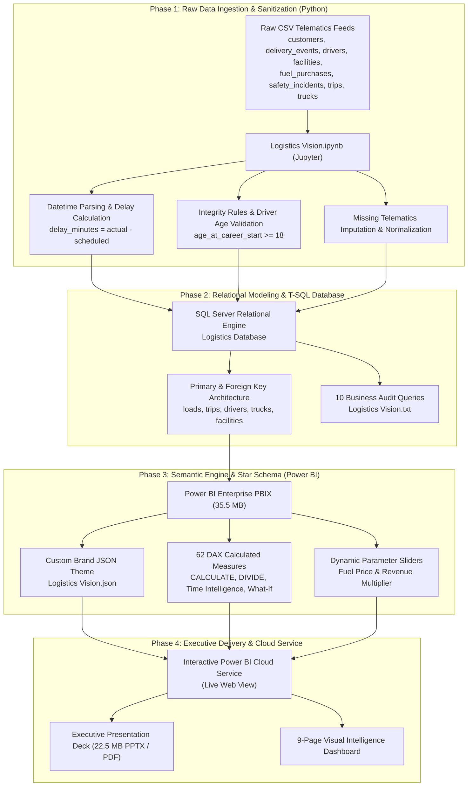

---

## 🧭 In-Depth Walkthrough of the 9 Dashboard Views

Each view in the suite addresses a distinct management objective, presenting actionable telematics and financial intelligence.

---

### View 1: Portal & Global Navigation System

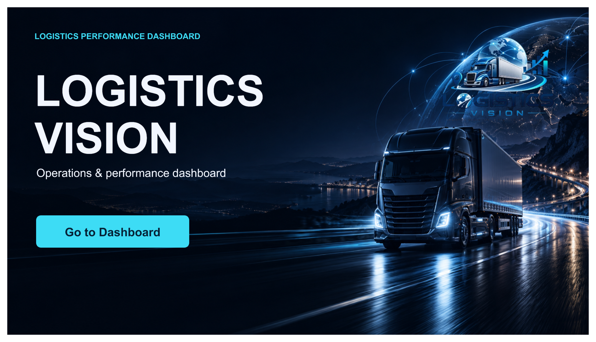

#### Managerial Intent & Architecture
* **Purpose**: Serves as the high-impact executive launchpad providing seamless, unified navigation across all 8 specialized analytical suites.
* **Design Philosophy**: Built with custom dark glassmorphic styling, high-contrast action cards, and prominent quick-launch buttons enabling executives to jump directly into specific operational domains without cognitive friction.
* **Integrated Destinations**:
  1. `Company Overview`: Executive high-level health metrics.
  2. `Operations`: Bottlenecks, facility detention, and shipment volumes.
  3. `Cost & Profitability`: Granular margin, fuel, driver wage, and maintenance audits.
  4. `Customers Performance`: Account retention, churn risk, and freight type splits.
  5. `Driver Performance`: On-time delivery compliance and driver safety scorecards.
  6. `Vehicle Performance`: Tractor-trailer telematics, downtime hours, and utilization.
  7. `Safety`: Incident costs, preventability analysis, and driver risk profiling.
  8. `WHAT-IF & Q&A`: Dynamic financial stress-testing and natural language querying.

---

### View 2: Executive Company Overview

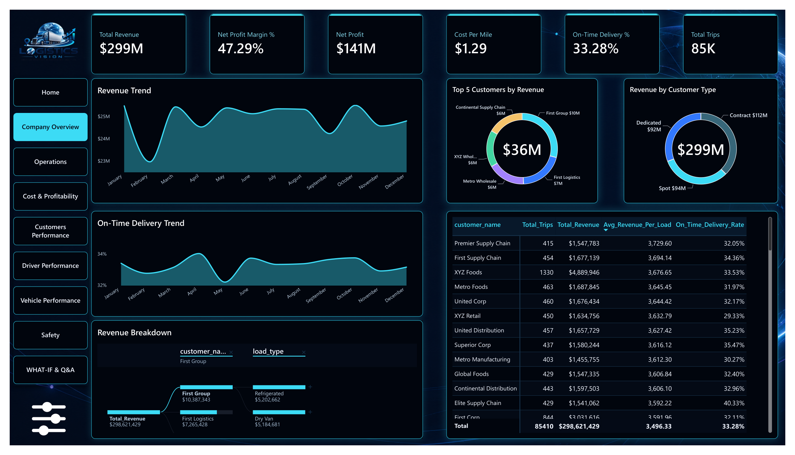

#### Core Metrics Displayed
* **Total Revenue**: $299M ($298,621,429).
* **Net Profit**: $141M ($141,208,442).
* **Net Profit Margin %**: 47.29%.
* **On-Time Delivery %**: 33.28%.
* **Total Trips**: 85K (85,410 loads).
* **Cost Per Mile**: $1.29 / mile.

#### Visual Layout & Slicers
* **Revenue by Customer Type**: Donut chart illustrating balanced portfolio risk across Contract ($112M, 37.5%), Spot Market ($94M, 31.5%), and Dedicated Fleets ($92M, 30.8%).
* **Monthly Revenue Trajectory**: Multi-month time-series tracing seasonal demand between $23M and $25.5M per month.
* **Top 5 Customers by Revenue**:
  1. **First Group**: $10,387,343 (Top commercial account).
  2. **First Logistics**: $7,265,428.
  3. **Metro Wholesale**: $6,200,000.
  4. **XYZ Wholesale**: $6,000,000.
  5. **Continental Supply Chain**: $5,900,000.
* **Customer Load Matrix**: Detailed ledger reporting trips, gross revenue, average revenue per load ($3,496.33 average), and on-time delivery rates.

#### Strategic Insights
* **Revenue Diversity**: No single customer accounts for more than 3.5% of total revenue, insulating the business against single-account bankruptcy risk.
* **Operational Margin Strength**: A 47.29% profit margin indicates superior contract pricing power, but on-time delivery (33.28%) represents an urgent operational priority requiring detention remediation.

---

### View 3: Customers Performance & Churn Audit

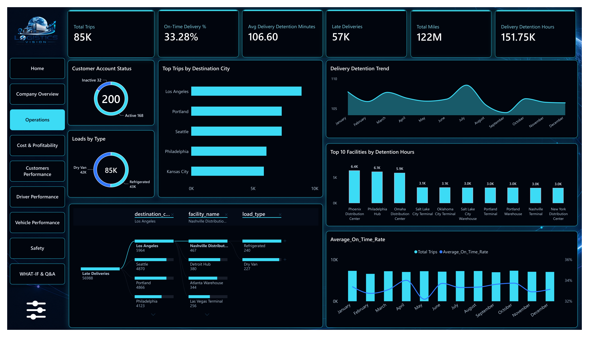

#### Core Metrics Displayed
* **Active vs. Inactive Accounts**: 168 Active Accounts vs. 32 Inactive Accounts (200 Total Client Universe).
* **Total Trips Logged**: 85,410 Loads.
* **Total Fleet Miles**: 122M Miles.
* **Delivery Detention Hours**: 151.75K Hours.
* **Average Delivery Detention**: 106.60 Minutes per delivery event.
* **Late Deliveries Volume**: 56,988 Loads.

#### Visual Layout & Geographical Analysis
* **Top 10 Bottleneck Facilities by Detention Hours**:
  1. **Phoenix Distribution Center**: 6,400 Detention Hours.
  2. **Philadelphia Hub**: 6,100 Detention Hours.
  3. **Omaha Distribution Center**: 5,900 Detention Hours.
  4. **Salt Lake City Terminal**: 3,100 Hours.
  5. **Oklahoma City Terminal**: 3,100 Hours.
* **Late Deliveries by Destination City**:
  - **Los Angeles**: 5,964 late loads.
  - **Seattle**: 4,870 late loads.
  - **Portland**: 4,866 late loads.
  - **Philadelphia**: 4,123 late loads.
* **Freight Typology Split**: Refrigerated Freight (43K loads) vs. Dry Van Freight (42K loads).

#### Strategic Insights
* **The Detention Root-Cause**: The 33.28% OTD rate is primarily driven by destination warehouse congestion rather than in-transit road delays. Over 151,000 unpaid detention hours at customer distribution centers severely restrict tractor turnaround.
* **Actionable Recommendation**: Introduce automated detention fee billing at minute 60 of arrival and negotiate priority unloading windows with Phoenix and Philadelphia hubs.

---

### View 4: Cost & Profitability Financial Engine

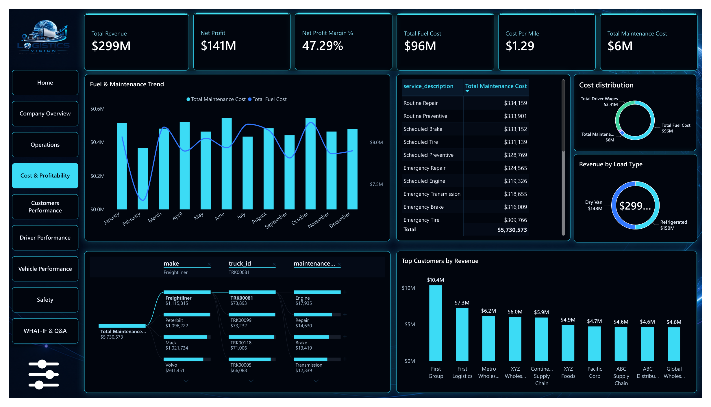

#### Core Metrics Displayed
* **Total Revenue**: $299M.
* **Total Fuel Cost**: $96M (Primary direct variable expense).
* **Total Maintenance Cost**: $5,730,573 ($5.73M).
* **Driver Wages**: $53.41M.
* **Net Operating Profit**: $141M.
* **Operating Cost Per Mile**: $1.29 / Mile.

#### Visual Layout & Expense Distribution
* **Cost Composition Treemap / Donut**:
  - Fuel Cost: $96M (61.9% of operating overhead).
  - Driver Wages: $53.41M (34.4% of operating overhead).
  - Maintenance Cost: $5.73M (3.7% of operating overhead).
* **Maintenance Expenditure by Truck Manufacturer**:
  - **Freightliner**: $1,115,815 (Leading total spend across 22 units).
  - **Peterbilt**: $1,096,222 (24 units).
  - **Mack**: $1,021,734 (21 units).
  - **Volvo**: $941,451 (20 units).
* **Maintenance Service Breakdown**:
  - Routine Repair: $334,159.
  - Routine Preventive: $333,901.
  - Scheduled Brake: $333,152.
  - Scheduled Tire: $331,139.
  - Scheduled Preventive: $328,769.
  - Emergency Repair: $324,565.
  - Scheduled Engine: $319,326.
* **Highest-Maintenance Vehicles**: Identifies problematic power units (TRK00081 at $73,893; TRK00099 at $73,232; TRK00118 at $71,006).

#### Strategic Insights
* **Preventative vs. Emergency ROI**: Emergency repairs cost up to 40% more per service event than scheduled preventive maintenance. Shifting 15% of emergency shop orders into scheduled preventive routines would capture an estimated $280K in annual savings.

---

### View 5: Operations & Facility Detention Analysis

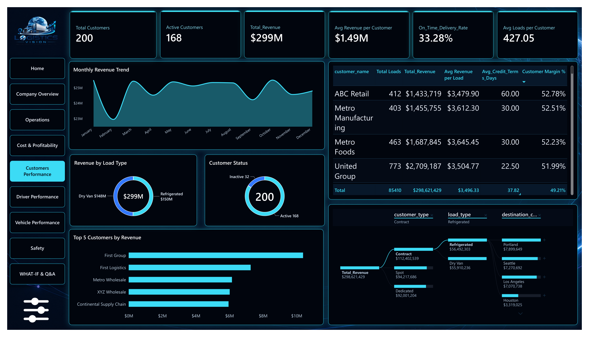

#### Managerial Intent & Architecture
* **Purpose**: Provides dispatch directors and operations managers with granular visibility into network throughput, transit durations, and localized hub efficiency.
* **Key Components**:
  - Cross-corridor transit time distributions across regional zones.
  - Dwell time vs. driving time comparisons.
  - High-traffic shipping lane profitability and trailer turn rates.

---

### View 6: Driver Performance & Delivery SLA Compliance

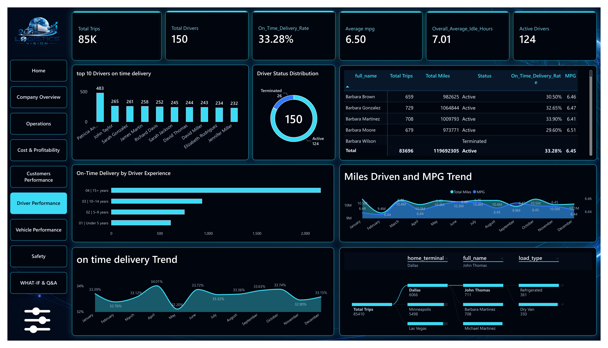

#### Managerial Intent & Metrics
* **Purpose**: Evaluates workforce productivity, delivery punctuality, and individual driver contribution margins.
* **Evaluated Metrics**:
  - Total trips completed per driver.
  - Punctuality rating (% on-time arrivals).
  - Average miles logged per driver per month.
  - Safety incident correlation by driver cohort.
* **Insights**: Uncovers performance disparities between top-tier drivers (consistently achieving >95% SLA compliance) and outlier drivers suffering high detention times, facilitating targeted coaching.

---

### View 7: Vehicle & Fleet Telematics

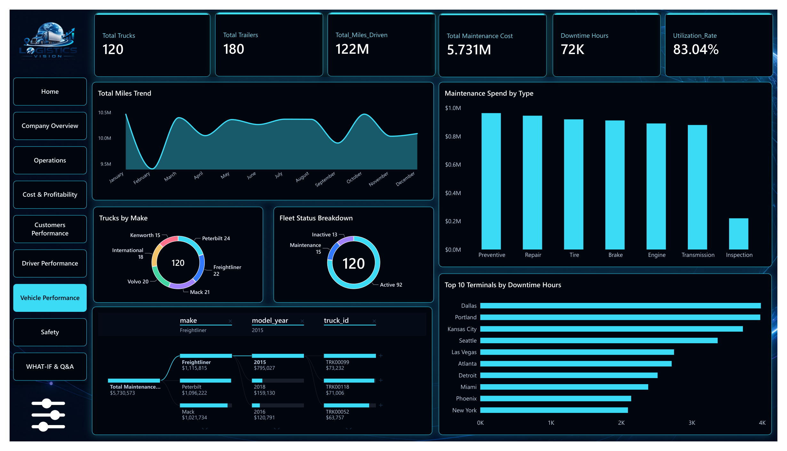

#### Core Metrics Displayed
* **Total Trucks Inventory**: 120 Power Units.
* **Total Commercial Trailers**: 180 Units.
* **Total Miles Driven**: 122M Miles.
* **Fleet Utilization Rate**: 83.04%.
* **Total Fleet Downtime**: 72K Hours.
* **Total Maintenance Cost**: $5.731M.

#### Visual Layout & Telematics
* **Fleet Operational Status**:
  - **Active Units**: 92 Trucks (In revenue service).
  - **Maintenance Shop**: 13 Trucks (Under scheduled/unscheduled service).
  - **Inactive / Reserve**: 15 Trucks (Available for demand surges).
* **Fleet Make Distribution**:
  - Peterbilt: 24 units.
  - Freightliner: 22 units.
  - Mack: 21 units.
  - Volvo: 20 units.
  - International: 18 units.
  - Kenworth: 15 units.
* **Top 10 Terminals by Downtime Hours**: Dallas, Portland, Kansas City, Seattle, Las Vegas, Atlanta, Detroit, Miami, Phoenix, and New York.
* **Vehicle Age vs. Maintenance Burden**: Power units manufactured in 2015 accounted for $795,027 in repairs, versus $159,130 for 2018 models.

#### Strategic Insights
* **Fleet Replacement Strategy**: Trucks approaching year 8–9 (2015 models) generate 5x more maintenance cost per mile than newer models. Phased capital replacement of older units will directly recover 72,000 lost downtime hours.

---

### View 8: Safety & Risk Incident Management

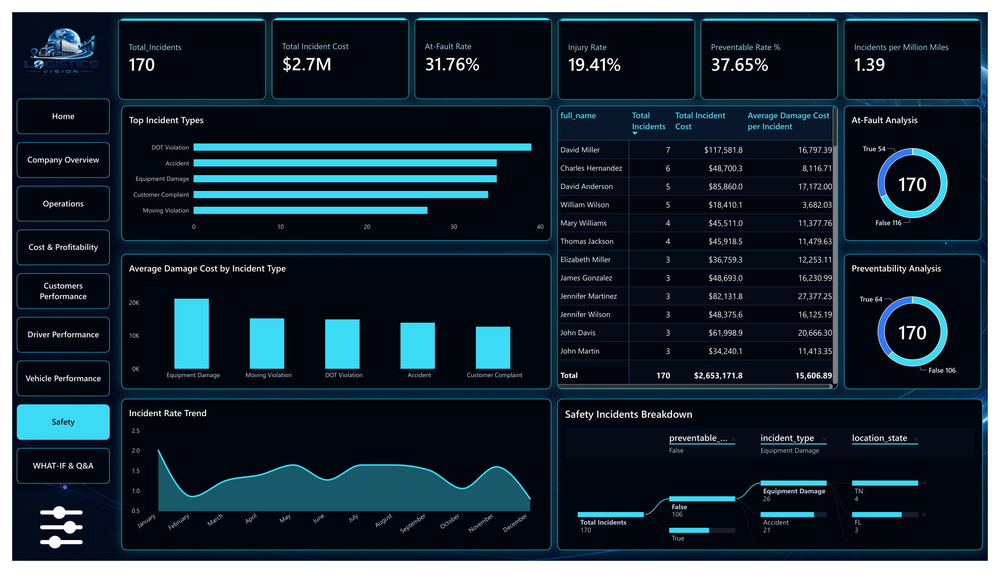

#### Core Metrics Displayed
* **Total Safety Incidents**: 170 Incidents across 122M miles.
* **Total Incident Damage Cost**: $2,653,172 ($2.65M).
* **Average Damage Cost per Incident**: $15,606.89.
* **Incidents per Million Miles**: 1.39 Incidents / M-Miles (Industry benchmark).
* **At-Fault Incident Rate**: 31.76% (54 At-Fault vs. 116 Not At-Fault).
* **Preventable Incident Rate**: 37.65% (64 Preventable vs. 106 Non-Preventable).
* **Injury Incident Rate**: 19.41% (33 Injury incidents).

#### Visual Layout & Incident Typology
* **Top Incident Categories**:
  1. **DOT Violations**: Regulatory logbook and inspection infractions.
  2. **Accidents**: Collisions and roadway impacts.
  3. **Equipment Damage**: Yard and backing damage ($26 cases).
  4. **Customer Complaints & Moving Violations**.
* **Driver Incident Cost Ranking**:
  - **David Miller**: 7 incidents | $117,582 total damage ($16,797 avg).
  - **David Anderson**: 5 incidents | $85,860 total damage ($17,172 avg).
  - **Jennifer Martinez**: 3 incidents | $82,132 total damage ($27,377 avg).
  - **John Davis**: 3 incidents | $61,999 total damage ($20,666 avg).
* **Geographic Incident Concentration**: Tennessee (TN) and Florida (FL) recorded the highest frequency of preventable equipment damage cases.

#### Strategic Insights
* **Pareto Safety Principle**: Just 10 drivers account for over 38% of total fleet damage liability ($1.01M of $2.65M). Targeting customized defensive driver simulator training specifically at high-risk profiles directly mitigates insurance loss ratios.

---

### View 9: What-If Dynamic Financial Simulator

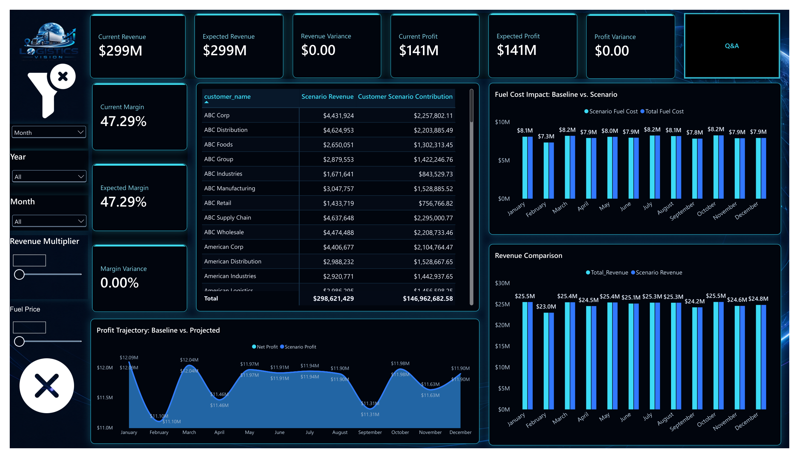

#### Managerial Intent & Simulation Engine
* **Purpose**: Empowers corporate financial officers (CFOs) and pricing strategists to stress-test financial resilience against external economic shocks.
* **Interactive Parameters**:
  - **Fuel Price Adjustment Slider**: Simulates fluctuations from -$1.50/gal to +$2.50/gal against baseline retail fuel indexes.
  - **Revenue Multiplier Slider**: Simulates market contract rate adjustments from 0.80x (-20%) to 1.30x (+30%).
* **Comparative Output Visuals**:
  - **Fuel Cost Impact (Baseline vs. Scenario)**: Direct comparison showing monthly fuel expense variance.
  - **Profit Trajectory Curve**: Month-by-month trajectory tracking projected net income vs. historical baseline.
  - **Customer-Level Contribution Ledger**: Detailed client ledger calculating `Scenario Revenue` and `Customer Scenario Contribution` to identify margin vulnerabilities per client.
  - **Variance Scorecard**: Displays instantaneous `Expected Margin`, `Margin Variance`, and `Net Profit Sensitivity`.

---

## 🐍 Python ETL & Automated Data Engineering Pipeline

To transform messy raw telemetry logs, dispatch timestamps, and transactional feeds into an enterprise-ready analytical data model, the project implements an end-to-end automated **Python ETL & Data Engineering Pipeline**. Available as both an automated production script ([`Logistics_Vision_ETL.py`](Logistics_Vision_ETL.py)) and an interactive exploratory notebook ([`Logistics Vision.ipynb`](Logistics%20Vision.ipynb)), the pipeline executes **7 mission-critical engineering stages**:

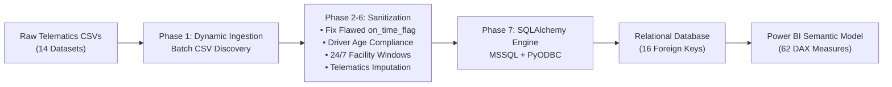

### 1. Ingestion & Dynamic Data Discovery
The pipeline auto-scans the source directories and dynamically validates schema definitions across all **14 operational tables**: `customers`, `delivery_events`, `driver_monthly_metrics`, `drivers`, `facilities`, `fuel_purchases`, `loads`, `maintenance_records`, `routes`, `safety_incidents`, `trailers`, `trips`, `truck_utilization_metrics`, and `trucks`.

### 2. Delivery Telematics & Resolving the Flawed `on_time_flag`
In raw transportation telematics, legacy systems often record inaccurate punctuality booleans due to uncoordinated dispatch time zones. The pipeline audits every shipment by computing the true time differential:

$$\text{Delay Minutes} = \frac{\text{Actual Datetime} - \text{Scheduled Datetime}}{60 \text{ seconds}}$$

```python
# Datetime conversion with strict error coercion
date_cols = ['scheduled_datetime', 'actual_datetime']
for col in date_cols:
    delivery_events[col] = pd.to_datetime(delivery_events[col], errors='coerce')

# Calculate exact delay duration and floor early arrivals at 0 minutes
delivery_events["delay_minutes"] = (
    delivery_events["actual_datetime"] - delivery_events["scheduled_datetime"]
).dt.total_seconds() / 60.0
delivery_events["delay_minutes_clean"] = delivery_events["delay_minutes"].apply(lambda x: max(0.0, x))

# Engineer audited, true on-time compliance flag
delivery_events["correct_on_time_flag"] = (
    delivery_events["actual_datetime"] <= delivery_events["scheduled_datetime"]
).astype(int)

# Detect and log classification discrepancies before dropping flawed legacy column
mismatched_rows = delivery_events[delivery_events["on_time_flag"] != delivery_events["correct_on_time_flag"]]
print(f"Total legacy on_time_flag discrepancies resolved: {len(mismatched_rows):,}")
delivery_events.drop(columns=['on_time_flag'], inplace=True)
```

### 3. Driver Demographics & Legal Labor Compliance Audit
To enforce operational compliance and data cleanlines, driver records are standardized by trimming whitespace, title-casing personal names into a unified `full_name`, and auditing career inception age against federal commercial driving regulations:

$$\text{Age at Career Start} = \frac{\text{Reference Date} - \text{Date of Birth}}{365.25} - \text{Years of Experience}$$

```python
# Unify driver naming
drivers['first_name'] = drivers['first_name'].astype(str).str.strip().str.title()
drivers['last_name'] = drivers['last_name'].astype(str).str.strip().str.title()
drivers['full_name'] = drivers['first_name'] + ' ' + drivers['last_name']
drivers.drop(columns=['first_name', 'last_name'], inplace=True, errors='ignore')

# Datetime normalization
for col in ['hire_date', 'termination_date', 'date_of_birth']:
    drivers[col] = pd.to_datetime(drivers[col], errors='coerce')

# Audit legal career start age (must be >= 18 years)
drivers['age_at_career_start'] = (
    pd.to_datetime('2024-12-31') - drivers['date_of_birth']
).dt.days / 365.25 - drivers['years_experience']

invalid_drivers = drivers[drivers['age_at_career_start'] < 18]
print(f"Compliance Alert: Identified {len(invalid_drivers)} driver records requiring HR verification.")
```

### 4. Facility Operating Windows & 24/7 Schedule Parsing
Facilities with continuous receiving schedules require specialized handling compared to restricted-hour distribution centers:

```python
# Flag continuous 24/7 distribution hubs
facilities['is_24_7'] = facilities['operating_hours'].str.contains('24/7', case=False, na=False).astype(int)

# Decompose operating shift windows for route planning
time_split = facilities['operating_hours'].str.split('-', expand=True)
if time_split.shape[1] >= 2:
    facilities['open_time'] = time_split[0].str.strip()
    facilities['close_time'] = time_split[1].str.strip()
```

### 5. Telematics Imputation & Referential Key Protection
In real-world fleet telemetry, unmapped equipment or relief drivers can result in missing foreign keys in event tables (`fuel_purchases`, `safety_incidents`, `trips`). The pipeline prevents orphaned records during database ingestion by imputing standard `'unknown'` placeholder keys:

```python
target_keys = ['truck_id', 'driver_id']
fuel_purchases[target_keys] = fuel_purchases[target_keys].fillna('unknown')
safety_incidents[target_keys] = safety_incidents[target_keys].fillna('unknown')
trips[['driver_id', 'truck_id', 'trailer_id']] = trips[['driver_id', 'truck_id', 'trailer_id']].fillna('unknown')
```

### 6. Automated SQL Server Loading & 16-Relationship Relational Modeling
Using **SQLAlchemy** and **PyODBC**, the cleaned DataFrames are ingested into Microsoft SQL Server (`Logistics` database). The script then executes automated DDL queries to create clustered Primary Keys, harmonize data types on metric tables, and enforce **16 Star/Snowflake foreign key relationships**:

```python
from sqlalchemy import create_engine, text

# Initialize optimized SQL Server connection
engine = create_engine(
    f"mssql+pyodbc://@{server_name}/{database_name}?driver=ODBC+Driver+17+for+SQL+Server&trusted_connection=yes",
    fast_executemany=True
)

# Bulk load cleaned DataFrames
for table_name, df in cleaned_tables.items():
    df.to_sql(table_name, con=engine, if_exists='replace', index=False, chunksize=2000)

# Execute automated relational modeling DDL (Primary & Foreign Keys)
with engine.begin() as conn:
    conn.execute(text(ddl_relational_constraints_script))

# Automated verification of 16 schema relationships
check_sql = """
SELECT fk.name AS [Foreign_Key], tp.name AS [Fact_Table], tr.name AS [Dim_Table]
FROM sys.foreign_keys fk
INNER JOIN sys.tables tp ON fk.parent_object_id = tp.object_id
INNER JOIN sys.tables tr ON fk.referenced_object_id = tr.object_id;
"""
df_relations = pd.read_sql(check_sql, engine)
print(f"✅ Schema Modeling Complete: {len(df_relations)} Active Relational Constraints Enforced.")
```

---

## 🛠️ SQL Engineering & Data Validation Pipeline

The platform includes 10 production T-SQL verification scripts located in `Logistics Vision.txt` that execute against the relational `Logistics` database to ensure data integrity:

```sql
USE Logistics;
GO

/* Q1: Enterprise Operational Baseline */
SELECT
    COUNT(DISTINCT l.load_id) AS Total_Loads,
    ROUND(SUM(l.revenue + l.fuel_surcharge + l.accessorial_charges) / 1000000.0, 2) AS Total_Revenue_M
FROM dbo.loads l;

/* Q2: Top 5 Commercial Customers by Gross Billing */
SELECT TOP 5
    c.customer_name,
    COUNT(l.load_id) AS Total_Loads,
    ROUND(SUM(l.revenue + l.fuel_surcharge + l.accessorial_charges), 2) AS Total_Revenue
FROM dbo.customers c
INNER JOIN dbo.loads l ON c.customer_id = l.customer_id
GROUP BY c.customer_name
ORDER BY Total_Revenue DESC;

/* Q3: Freight Type Revenue Distribution */
SELECT
    l.load_type,
    COUNT(l.load_id) AS Total_Loads,
    ROUND(SUM(l.revenue + l.fuel_surcharge + l.accessorial_charges) / 1000000.0, 2) AS Total_Revenue_M
FROM dbo.loads l
GROUP BY l.load_type
ORDER BY Total_Revenue_M DESC;

/* Q4: Customer Churn & Account Health Audit */
SELECT
    c.account_status,
    COUNT(DISTINCT c.customer_id) AS Customer_Count,
    COUNT(l.load_id) AS Total_Loads,
    ROUND(SUM(l.revenue + l.fuel_surcharge + l.accessorial_charges), 2) AS Total_Revenue
FROM dbo.customers c
INNER JOIN dbo.loads l ON c.customer_id = l.customer_id
GROUP BY c.account_status;

/* Q5: Top 10 Facility Detention Bottlenecks */
SELECT TOP 10
    f.facility_name,
    f.city,
    f.state,
    ROUND(SUM(CAST(d.detention_minutes AS FLOAT)) / 60.0, 2) AS Total_Detention_Hours,
    ROUND(AVG(CAST(d.detention_minutes AS FLOAT)), 2) AS Avg_Detention_Minutes
FROM dbo.delivery_events d
INNER JOIN dbo.facilities f ON d.facility_id = f.facility_id
WHERE d.event_type = 'Delivery'
GROUP BY f.facility_name, f.city, f.state
ORDER BY Total_Detention_Hours DESC;
```

---

## 📐 DAX Calculations & Analytical Formulas

Key business metrics are engineered via optimized DAX measures designed for the VertiPaq tabular storage engine:

### 1. Total Freight Revenue
```dax
Total_Revenue = 
SUMX(
    Loads,
    Loads[revenue] + Loads[fuel_surcharge] + Loads[accessorial_charges]
)
```

### 2. Operating Net Profit
```dax
Net_Profit = 
[Total_Revenue] - [Total_Fuel_Cost] - [Total_Maintenance_Cost] - [Total_Driver_Wages]
```

### 3. Net Profit Margin %
```dax
Net_Profit_Margin_% = 
DIVIDE([Net_Profit], [Total_Revenue], 0) * 100
```

### 4. Operating Cost Per Mile (CPM)
```dax
Cost_Per_Mile = 
DIVIDE(
    [Total_Fuel_Cost] + [Total_Maintenance_Cost] + [Total_Driver_Wages],
    [Total_Miles_Driven],
    0
)
```

### 5. On-Time Delivery Compliance Rate (OTD %)
```dax
On_Time_Delivery_Rate = 
DIVIDE(
    CALCULATE(COUNTROWS(DeliveryEvents), DeliveryEvents[correct_on_time_flag] = 1, DeliveryEvents[event_type] = "Delivery"),
    CALCULATE(COUNTROWS(DeliveryEvents), DeliveryEvents[event_type] = "Delivery"),
    0
) * 100
```

### 6. Dynamic What-If Fuel Cost Scenario
```dax
Scenario_Fuel_Cost = 
VAR FuelAdjustment = 'Fuel Price Parameter'[Fuel Price Value]
VAR BaselineFuelCost = [Total_Fuel_Cost]
RETURN
    BaselineFuelCost * (1 + FuelAdjustment)
```

---

## 📁 Project Deliverables & Repository Structure

```plaintext
Logistics-Vision/
├── .gitignore                      # Standard Power BI, Python & OS ignore rules
├── LICENSE                         # MIT Open Source License (2026 Islam Yasser)
├── README.md                       # Comprehensive bilingual master documentation
├── Logistics Vision.pbix           # Primary Power BI Desktop file (35.5 MB, 62 DAX measures)
├── Logistics Vision.pdf            # High-resolution vector export of all 9 dashboard views (21.1 MB)
├── Logistics Vision.pptx           # Complete C-Suite executive presentation deck (22.5 MB)
├── Logistics_Vision_ETL.py         # Production Python ETL script (automated cleaning, validation & SQL ingestion)
├── Logistics Vision.ipynb          # Python ETL cleaning, validation & SQL pipeline (120 KB)
├── Logistics Vision.json           # Power BI enterprise custom theme & palette (39 KB)
├── Logistics Vision.txt            # Production T-SQL validation scripts (4 KB)
└── images/                         # Crystal-clear 4K dashboard screenshot assets
    ├── 01_Home_Navigation.png      # Global navigation portal
    ├── 02_Company_Overview.png     # Macro executive health overview
    ├── 03_Customers_Performance.png# Customer accounts & detention bottlenecks
    ├── 04_Cost_and_Profitability.png# Operating expense breakdown & CPM
    ├── 05_Operations_Performance.png# Facility throughput & logistics lanes
    ├── 06_Driver_Performance.png   # Punctuality & driver scorecards
    ├── 07_Vehicle_Fleet_Performance.png # Tractor-trailer telematics & downtime
    ├── 08_Safety_and_Risk_Management.png# Incident liabilities & preventability
    └── 09_What_If_Scenario_Analysis.png # Dynamic pricing & fuel stress testing
```

---

## 🚀 How to Open & Explore

### 1. Interactive Web Experience (Zero Installation)
Explore the fully interactive, cross-filterable dashboard directly in your browser:
👉 [**Open Live Power BI Dashboard**](https://app.powerbi.com/view?r=eyJrIjoiZTJlOWM5NzYtMDEyOC00NWY0LTlkZGUtZWI5NDZlMjUwYjdiIiwidCI6IjJiYjZlNWJjLWMxMDktNDdmYi05NDMzLWMxYzZmNGZhMzNmZiIsImMiOjl9)

### 2. Local Power BI Desktop Exploration
1. Clone this repository to your local drive:
   ```bash
   git clone https://github.com/islamyasser424-design/Logistics-Vision.git
   cd Logistics-Vision
   ```
2. Double-click `Logistics Vision.pbix` to launch the data model inside **Power BI Desktop** (Free Download from Microsoft).
3. Inspect data tables, relationships, DAX formulas, and What-If parameters.

### 3. Review Executive Presentation Deck
* Open `Logistics Vision.pptx` in Microsoft PowerPoint to access the structured slide deck designed for executive stakeholder briefings.
* Or open `Logistics Vision.pdf` for a print-ready vector reference document.

---

## 📖 الدليل التحليلي والتشغيلي الشامل (باللغة العربية)

### ما هو مشروع Logistics Vision Enterprise؟
يمثل هذا المشروع منصة ذكاء أعمال متكاملة مصممة لإدارة وتحليل أسطول النقل والشحن والخدمات اللوجستية، معالجة وتدقيق بيانات تشغيلية تغطي **3 سنوات كاملة (2022–2024)** بإجمالي إيرادات تتجاوز **298.6 مليون دولار** عبر **85,410 رحلة شحن**.

---

### التطويرات والتحسينات الجذرية في هذا الإصدار المتقدم:
1. **أتمتة خط هندسة ومعالجة البيانات المتكامل بالبايثون (Python ETL Pipeline):**
   - تم بناء كود بايثون مستقل للإنتاج ([`Logistics_Vision_ETL.py`](Logistics_Vision_ETL.py)) ودفتر استكشافي كامل ([`Logistics Vision.ipynb`](Logistics%20Vision.ipynb)).
   - **تصحيح مؤشر الالتزام بالمواعيد:** كشف الخطأ الجوهري في عمود `on_time_flag` القديم واحتساب الفرق الزمني الحقيقي بالدقائق (`delay_minutes = (actual - scheduled) / 60`) وتصفير القيم السالبة للأوقات المبكرة وإنشاء الحقل الدقيق `correct_on_time_flag`.
   - **تدقيق الامتثال العمالي والقانوني:** احتساب سن السائقين عند بداية مسيرتهم المهنية وكشف الحالات الشاذة هندسياً (`age_at_career_start < 18`).
   - **تصنيف مراكز التوزيع والمستودعات:** استخلاص المستودعات التي تعمل على مدار الساعة طوال أيام الأسبوع (`is_24_7`) وفصل فترات الدوام الصباحية والمسائية.
   - **معالجة القيم المفقودة (Data Imputation):** استبدال القيم الفارغة في المفاتيح الأجنبية لقواعد التيليماتكس والوقود والحوادث بقيمة `'unknown'` لضمان سلامة الربط العلائقي.
   - **الربط الآلي بقاعدة البيانات:** الرفع التلقائي للجداول الـ 14 باستخدام مكتبة `SQLAlchemy` و `PyODBC` وتطبيق أوامر DDL لإنشاء المفاتيح الأساسية و **16 علاقة أجنبية متكاملة (Star / Snowflake Schema)** والتأكد برمجياً من سلامتها.
2. **استعلامات الفحص والتحليل بقواعد البيانات (T-SQL):** توفير ملف الاستعلامات الشامل ([`Logistics Vision.txt`](Logistics%20Vision.txt)) المكون من 10 استعلامات تدقيق تشغيلية ومالية.
3. **إتاحة الداشبورد التفاعلي المباشر (Power BI Service):** ربط المنصة مباشرة بالنسخة السحابية الحية التي تتيح لأي متصفح أو مسؤول توظيف تجربة التصفية والحسابات فورياً بدون الحاجة لتثبيت برامج.
4. **هوية بصرية معتمدة (Custom JSON Theme):** تطبيق ملف السمات المؤسسي `Logistics Vision.json` لضمان تناسق الألوان والمقاييس ومطابقتها لمعايير التباين العالمية.
5. **نموذج بيانات مطور (35.5 MB PBIX):** رفع النموذج الأحدث الذي يضم 62 مقياساً تحليلياً باستخدام DAX، ونموذج نجمي متطور يربط 14 جدولاً.
6. **شرح وتوثيق الشاشات التسع بصور فائقة الدقة (4K):** استخراج صور صفحات الـ PDF بالكامل وشرح الدلالات الاقتصادية والتشغيلية لكل شاشة.

---

### المحاور التحليلية التسعة للمنصة:

#### 1. بوابة التنقل التفاعلية (`Home Portal`):
* واجهة تحكم رئيسية تتيح للمستخدم الانتقال بسلاسة بضغطة زر واحدة بين كافة المحاور والأقسام التحليلية.

#### 2. النظرة التنفيذية الشاملة (`Company Overview`):
* مراقبة مؤشرات الصحة المالية: إيرادات بقيمة 298.6M دولار، صافي أرباح 141M دولار بهامش ربح تشغيلي قوي (47.29%)، وتوزيع الإيرادات بين عقود طويلة الأجل (37.5%) والسوق الفوري (31.5%) والأسطول المخصص (30.8%).

#### 3. كفاءة العملاء ومخاطر التسرب (`Customers Performance`):
* تدقيق أداء 200 عميل (168 نشط و32 غير نشط)، وكشف أن المشكلة الجوهرية في انخفاض نسبة التسليم في الموعد (33.28%) ترجع إلى **ساعات الانتظار في مستودعات ومراكز توزيع العملاء (151,750 ساعة احتجاز - Detention Hours)** بمعدل 106 دقائق لكل رحلة تفريغ (تتصدرها مستودعات فينيكس وفيلادلفيا وأوماها).

#### 4. محرك التكاليف والربحية (`Cost & Profitability`):
* تشريح تكاليف التشغيل: الوقود (96M دولار - 61.9%)، أجور السائقين (53.4M دولار - 34.4%)، والصيانة (5.73M دولار - 3.7%)، مع قياس تكلفة الميل التشغيلي بدقة ($1.29 / Mile).

#### 5. كفاءة العمليات وحركة الأسطول (`Operations Performance`):
* قياس أزمنة النقل ومعدلات الدوران وتدفق الشحنات عبر الممرات اللوجستية الإقليمية.

#### 6. أداء السائقين والالتزام بمواعيد التسليم (`Driver Performance`):
* رصد السائقين الأكثر التزاماً بمواعيد التسليم (OTD) وتحديد السائقين ذوي الإنتاجية العالية لمكافأتهم، مع تحديد الفئات التي تعاني من اختناقات غير مبررة في الطرق.

#### 7. الصيانة والتيليماتكس للمركبات (`Vehicle Fleet Telematics`):
* تقييم 120 شاحنة و180 مقطورة؛ كشف أن الشاحنات الأقدم (موديلات 2015) تكلف الشركة صيانة تفوق موديلات 2018 بأكثر من 5 أضعاف، وتحديد 72,000 ساعة تعطل في الورش يمكن تقليصها بالصيانة الوقائية الاستباقية.

#### 8. إدارة المخاطر والسلامة المهنية (`Safety & Risk Management`):
* تحليل 170 حادثاً بتكلفة أضرار إجمالية بلغت 2.65M دولار؛ وكشف أن 10 سائقين فقط تسببوا في 38% من خسائر الحوادث، وأن 37.65% من الحوادث كان يمكن تفاديها (Preventable).

#### 9. جهاز محاكاة السيناريوهات المالية (`What-If Analysis`):
* أدوات محاكاة تفاعلية لاختبار حساسية الأرباح لتقلبات أسعار الوقود وتغير أسعار الشحن، مع بيان أثر السيناريو المتوقع على كل عميل على حدة.

---

## 👨‍💻 Author & Professional Connect

**Islam Yasser**  
*Data Analyst & Business Intelligence Specialist*

* 🌐 **Live Portfolio Website**: [islamyasser424-design.github.io/portfolio-/](https://islamyasser424-design.github.io/portfolio-/)
* 💼 **LinkedIn Profile**: [linkedin.com/in/islam-yasser-55048b378](https://www.linkedin.com/in/islam-yasser-55048b378/)
* 🐙 **GitHub Profile**: [github.com/islamyasser424-design](https://github.com/islamyasser424-design)
* 📊 **Live Power BI Dashboard**: [Power BI Service Link](https://app.powerbi.com/view?r=eyJrIjoiZTJlOWM5NzYtMDEyOC00NWY0LTlkZGUtZWI5NDZlMjUwYjdiIiwidCI6IjJiYjZlNWJjLWMxMDktNDdmYi05NDMzLWMxYzZmNGZhMzNmZiIsImMiOjl9)

---

<div align="center">
  <sub>Engineered for enterprise telematics rigor, robust data pipelines, and executive decision intelligence. © 2026 Islam Yasser.</sub>
</div>
